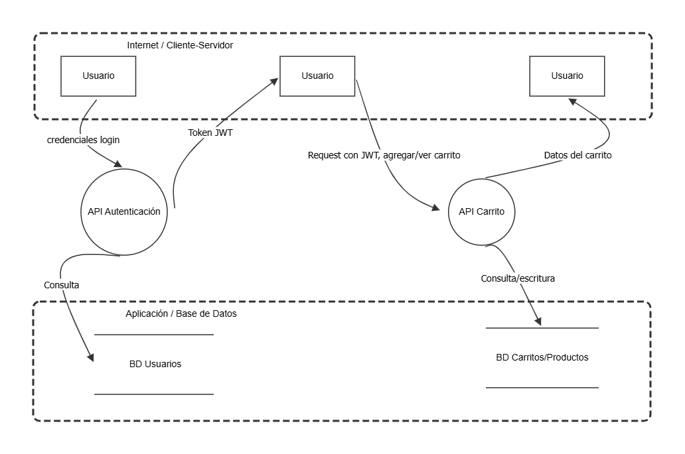

## 2. Modelado de Amenazas (DFD + STRIDE)

El modelado de amenazas se realizó sobre los dos flujos auditados en la sección 1: **autenticación (login)** y **gestión del carrito**, usando OWASP Threat Dragon.

### 2.1 Diagrama de Flujo de Datos (DFD)

El diagrama identifica:
- **Entidades externas:** Usuario (navegador del cliente)
- **Procesos:** API Autenticación, API Carrito
- **Almacenes de datos:** BD Usuarios, BD Carritos/Productos
- **Límites de confianza:**
  - *Internet / Cliente-Servidor* — separa al usuario (no confiable) de los procesos del servidor.
  - *Aplicación / Base de Datos* — separa la capa de aplicación de la capa de persistencia.

El archivo del modelo se encuentra en `02-modelado-amenazas/` de este repositorio (modelo de Threat Dragon, formato `.json`).

### 2.2 Análisis de Amenazas — Metodología STRIDE

| Categoría | Amenaza identificada | Dónde aplica | Justificación técnica | Mitigación |
|---|---|---|---|---|
| **S**poofing | Suplantación de identidad mediante inyección SQL en el login, evitando la verificación real de credenciales | Flujo 1 (`credenciales login`) → API Autenticación | La consulta SQL se construye por concatenación de strings, permitiendo que el payload `' OR 1=1--` altere la lógica de la consulta y devuelva un usuario válido sin conocer su contraseña (explotado en la sección 1.1) | Consultas parametrizadas (prepared statements); autenticación multifactor para cuentas privilegiadas |
| **T**ampering | Modificación no autorizada de datos del carrito de otro usuario | Flujo 5 (`consulta/escritura`) → API Carrito → BD Carritos/Productos | El endpoint `DELETE /api/BasketItems/<id>` no valida que el ítem pertenezca al usuario del token, permitiendo alterar/eliminar datos ajenos (explotado en la sección 1.4) | Validar en servidor que el recurso (`BasketItem.BasketId`) pertenece al usuario autenticado antes de cualquier escritura |
| **R**epudiation | Ausencia de registro de auditoría sobre qué usuario realizó cambios en un carrito, lo que impide rastrear accesos indebidos | API Carrito | No se observan logs de auditoría asociados a las operaciones de escritura sobre el carrito; un atacante que modifique datos ajenos no deja rastro verificable | Implementar logging estructurado (usuario, acción, recurso, timestamp) y centralizarlo en un sistema de monitoreo |
| **I**nformation Disclosure | Exposición del carrito de otro usuario mediante referencia directa a objetos (IDOR) | Flujo 4 (`request con JWT`) → API Carrito | El endpoint `GET /rest/basket/<id>` devuelve el carrito solicitado solo validando que el token sea válido, no que el carrito pertenezca al usuario autenticado (explotado en la sección 1.3) | Autorización a nivel de objeto: verificar `basket.UserId === token.UserId` antes de responder |
| **D**enial of Service | Fuerza bruta sin restricciones contra el endpoint de login, agotando recursos del servidor y facilitando el compromiso de cuentas | Flujo 1 (`credenciales login`) → API Autenticación | No se observó bloqueo, retardo progresivo ni CAPTCHA tras múltiples intentos fallidos consecutivos (confirmado en la sección 1.5) | Rate limiting por IP/usuario, bloqueo temporal de cuenta tras N intentos fallidos, CAPTCHA |
| **E**levation of Privilege | Acceso a funciones administrativas mediante credenciales por defecto no rotadas | API Autenticación → panel de administración | La cuenta `admin@juice-sh.op` mantiene la contraseña por defecto `admin123`, permitiendo escalar de usuario anónimo a administrador con una sola petición de login (explotado en la sección 1.5) | Forzar cambio de contraseña en primer uso, política de complejidad mínima, nunca desplegar credenciales por defecto en producción |

### 2.3 Conclusión de la sección

Las amenazas identificadas bajo STRIDE corresponden directamente a las vulnerabilidades explotadas en la sección 1, confirmando que los controles de autenticación y autorización del flujo de login y carrito son insuficientes en el estado actual de la aplicación. Las mitigaciones propuestas atacan la causa raíz en cada caso (validación de propiedad de recursos, parametrización de consultas, controles de fuerza bruta) y no solo el síntoma observado.

 
