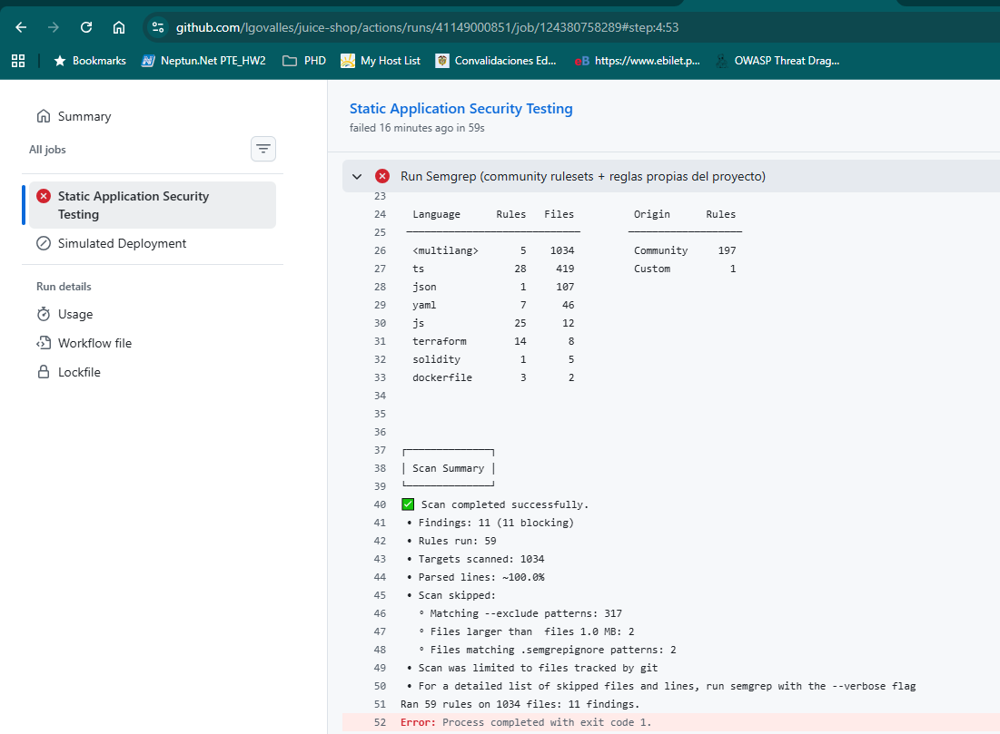
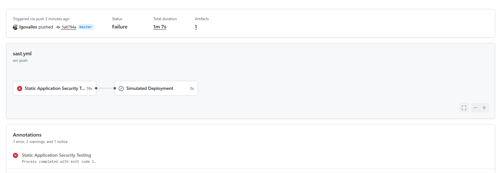
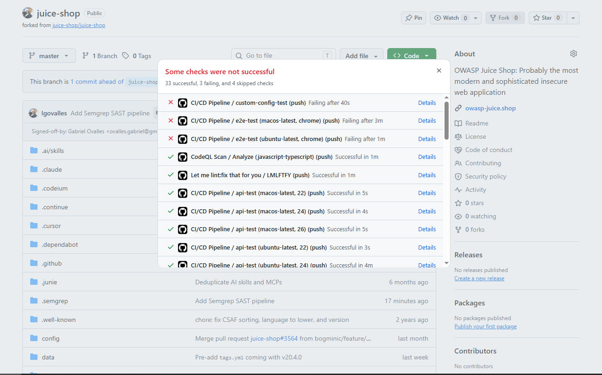
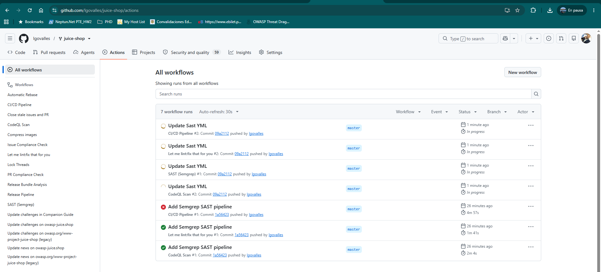
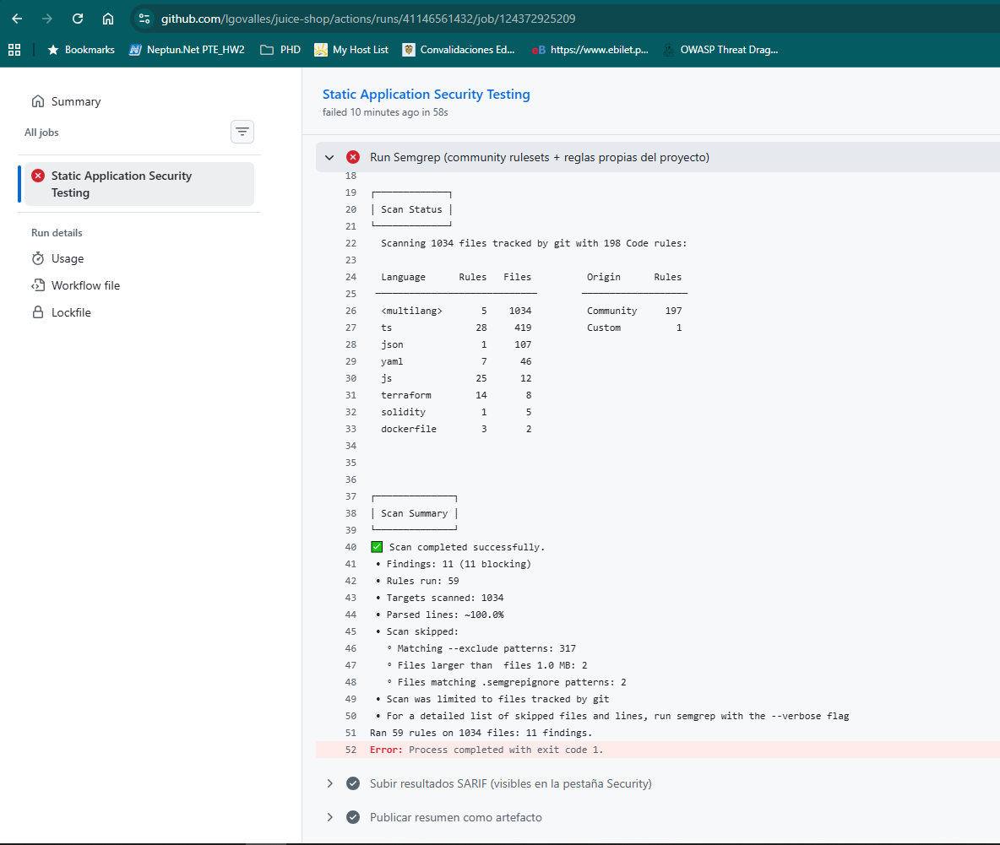

## 4. Pipeline CI/CD con SAST

Pipeline y reglas implementados sobre el fork donde se audita la aplicación: [lgovalles/juice-shop](https://github.com/lgovalles/juice-shop).

- Workflow: [`.github/workflows/sast.yml`](https://github.com/lgovalles/juice-shop/blob/main/.github/workflows/sast.yml)
- Reglas propias: [`.semgrep/custom-rules.yml`](https://github.com/lgovalles/juice-shop/blob/main/.semgrep/custom-rules.yml)

## 4.1. Herramienta y diseño del pipeline

Se eligió **Semgrep**, una herramienta SAST de código abierto que puede ejecutarse sin depender de una licencia comercial, integrada en un workflow de **GitHub Actions**. Según la configuración documentada, el workflow se dispara ante eventos `push` y `pull_request` en las ramas `main`,  `master` y `develop`. La ejecución compartida para la prueba de bloqueo se activó mediante un `push` a `master`.

El análisis combina dos fuentes de reglas:

1. **Rulesets comunitarios:** `p/owasp-top-ten`, `p/javascript`, `p/typescript` y `p/security-audit`, que proporcionan cobertura general para JavaScript, TypeScript y patrones de seguridad de aplicaciones web.
2. **Reglas propias del proyecto:** `.semgrep/custom-rules.yml`, elaboradas para identificar patrones relacionados con las vulnerabilidades analizadas manualmente en la sección 1.

El comando utiliza `--severity ERROR` y `--error`, de modo que los hallazgos seleccionados producen un código de salida distinto de cero y marcan el job como fallido. Los resultados se generan en formato SARIF. La configuración documentada contempla su publicación mediante `github/codeql-action/upload-sarif`.

Se excluye `data/static/codefixes/` del escaneo porque contiene ejemplos educativos intencionalmente vulnerables y no forma parte de las rutas productivas analizadas.

### 4.1.1. Configuración de referencia

El siguiente extracto recoge el job de Semgrep descrito en el informe, junto con la dependencia usada para la prueba de despliegue simulado. Debe cotejarse con el `sast.yml` vigente antes de copiarlo o ejecutarlo.

```yaml
name: SAST (Semgrep)

on:
  push:
    branches: [main, develop]
  pull_request:
    branches: [main, develop]

jobs:
  semgrep:
    name: Static Application Security Testing
    runs-on: ubuntu-latest
    permissions:
      contents: read
      security-events: write
    container:
      image: semgrep/semgrep
    steps:
      - uses: actions/checkout@v4
      - name: Run Semgrep (community rulesets + reglas propias del proyecto)
        run: |
          semgrep scan \
            --config p/owasp-top-ten \
            --config p/javascript \
            --config p/typescript \
            --config p/security-audit \
            --config .semgrep/custom-rules.yml \
            --exclude "frontend/node_modules" --exclude "node_modules" \
            --exclude "test" --exclude "cypress" --exclude "data/static/codefixes" \
            --severity ERROR --error \
            --sarif --output semgrep-results.sarif
      - name: Subir resultados SARIF (pestaña Security)
        if: always()
        uses: github/codeql-action/upload-sarif@v3
        with:
          sarif_file: semgrep-results.sarif

  deploy:
    name: Simulated Deployment
    needs: semgrep
    runs-on: ubuntu-latest
    steps:
      - name: Verify deployment authorization
        run: echo "Deployment allowed - SAST passed"
```

**Alcance de la configuración:** `needs: semgrep` condiciona la ejecución de `deploy` al éxito del job SAST. Este ejemplo no constituye, por sí mismo, una regla de protección de rama ni una integración con un entorno de producción.

## 4.2. Ejecución contra el código fuente de Juice Shop

Se ejecutó Semgrep sobre el código fuente de OWASP Juice Shop, la misma aplicación utilizada en los apartados de explotación de vulnerabilidades, modelado de amenazas y ASVS.

### 4.2.1. Resultados del análisis comunitario inicial

Según los resultados documentados durante el desarrollo del proyecto, el análisis inicial con rulesets comunitarios produjo **61 hallazgos en 1.193 archivos analizados**, correspondientes a **24 reglas distintas activadas**. Entre los patrones identificados se incluyeron:

- Secretos embebidos en código, como `hardcoded-jwt-secret` y `hardcoded-hmac-key`, en `lib/insecurity.ts`.
- Uso de `eval` en `routes/captcha.ts` y `routes/userProfile.ts`.
- Posible exposición de listados de directorios en `server.ts`.

El análisis comunitario inicial **no detectó la inyección SQL real** explotada en la sección 1.1. Las reglas genéricas de seguimiento de datos activaron alertas en ejemplos de `data/static/codefixes/`, pero no sobre los puntos vulnerables de `routes/login.ts` y `routes/search.ts`.

**Importante:** estos resultados pertenecen a una ejecución inicial y no deben confundirse con la ejecución posterior de GitHub Actions, que registró 11 hallazgos bloqueantes en 1.034 archivos.

### 4.2.2. Resultados de las reglas específicas del proyecto

Las reglas elaboradas a partir de los hallazgos de pruebas manuales identificaron los siguientes patrones:

| Regla | Archivo y línea | Relación con el análisis manual |
|---|---|---|
| `raw-sql-template-literal-concat` | `routes/login.ts:34` | Patrón de consulta SQL con interpolación de entrada del usuario; coincide con el punto explotado en la sección 1.1 mediante `' OR 1=1--`. |
| `raw-sql-template-literal-concat` | `routes/search.ts:23` | Punto adicional de inyección SQL en la búsqueda de productos. |
| `innerhtml-assignment-unsanitized` | `frontend/src/hacking-instructor/index.ts:126` | Asignación directa a `innerHTML`; patrón relacionado con riesgos de XSS basado en DOM. |
| `innerhtml-assignment-unsanitized` | `frontend/src/hacking-instructor/index.ts:142` | Segunda coincidencia del mismo patrón. |

El ruleset comunitario también señaló `routes/redirect.ts:18` como posible redirección abierta (`express-open-redirect`). La revisión documentada indica que la ruta aplica una comprobación mediante `security.isRedirectAllowed` antes de redirigir, consistente con la respuesta HTTP `406` obtenida en las pruebas dinámicas del requisito ASVS 5.1.5. Este caso se clasificó como **posible falso positivo**, sujeto al alcance de la ruta y de la lista de destinos permitidos.

Este contraste demuestra que las pruebas estáticas y dinámicas son complementarias: las reglas genéricas pueden omitir patrones particulares y también pueden reportar coincidencias que requieren interpretación manual.

## 4.3. Validación del bloqueo del despliegue simulado

### 4.3.1. Objetivo

Comprobar que la detección de vulnerabilidades bloqueantes por Semgrep impide la ejecución de una etapa posterior de despliegue **simulado** dentro de GitHub Actions.

### 4.3.2. Mecanismo implementado

Se incorporó un job denominado `Simulated Deployment` que depende del job de análisis SAST mediante la directiva `needs`. Esta dependencia hace que GitHub Actions omita el job de despliegue cuando el análisis de seguridad termina con error.

La ejecución se activó mediante un evento `push` en la rama `master`, tal como se observa en la captura del resumen del workflow.

### 4.3.3. Procedimiento de prueba

1. Ejecutar el workflow `sast.yml` mediante un `push` al repositorio auditado.
2. Confirmar que GitHub Actions realiza el checkout y ejecuta Semgrep.
3. Revisar el resumen de hallazgos y el código de salida del análisis.
4. Consultar el diagrama de jobs de la ejecución.
5. Verificar que `Static Application Security Testing` termina en `Failure` y que `Simulated Deployment` figura como `Skipped`.

### 4.3.4. Resultados observados

| Indicador | Evidencia observada |
|---|---|
| Archivos analizados | **1.034** |
| Reglas disponibles en la configuración del análisis | **198** (197 comunitarias y 1 personalizada, según el log de estado) |
| Reglas efectivamente ejecutadas | **59** |
| Hallazgos detectados | **11** |
| Hallazgos bloqueantes | **11** |
| Finalización del escaneo | `Scan completed successfully.` |
| Código de salida | **1** |
| Job `Static Application Security Testing` | **Failure** |
| Job `Simulated Deployment` | **Skipped** |
| Resultado general del workflow | **Failure** |
| Artefactos mostrados en el resumen | **1** |

Fragmento relevante del log:

```text
Scan completed successfully.
Findings: 11 (11 blocking)
Rules run: 59
Targets scanned: 1034
Ran 59 rules on 1034 files: 11 findings.
Error: Process completed with exit code 1.
```

La expresión `Scan completed successfully` significa que el **escaneo se completó técnicamente**, no que la aplicación haya superado el control de seguridad. El resultado del workflow fue fallido debido a los hallazgos bloqueantes.

**Evidencia 4-A — Registro de Semgrep.** Insertar la captura del log donde se observan `Findings: 11 (11 blocking)` y `exit code 1`.





### 4.3.5. Interpretación y alcance de la prueba

La ejecución demuestra un control preventivo funcional dentro del workflow: cuando Semgrep devuelve un error por hallazgos bloqueantes, el job dependiente no se ejecuta. Por tanto, se considera **satisfactoria la prueba de bloqueo del despliegue simulado**.

No obstante, esta evidencia **no demuestra** por sí sola que un despliegue real a producción esté bloqueado, ni que GitHub impida fusionar un pull request a una rama protegida. Para acreditar un bloqueo de merge se requeriría una regla de protección o *ruleset* con el check SAST obligatorio y una prueba de pull request rechazado.

## 4.4. Conclusiones del hito

La combinación de rulesets comunitarios y reglas específicas de la aplicación permitió vincular los hallazgos manuales de inyección SQL con un control automatizado de análisis estático. El análisis comunitario inicial, por sí solo, no identificó los puntos de SQLi explotados; las reglas específicas añadieron detección sobre los patrones observados en `routes/login.ts` y `routes/search.ts`.

En la ejecución documentada de GitHub Actions, Semgrep identificó **11 hallazgos bloqueantes**, finalizó con **código 1** y provocó que la etapa **`Simulated Deployment`** quedara en estado **`Skipped`**. Esto constituye evidencia reproducible de que un fallo del análisis SAST impide continuar hacia una etapa dependiente de despliegue simulado.


 

 

 
